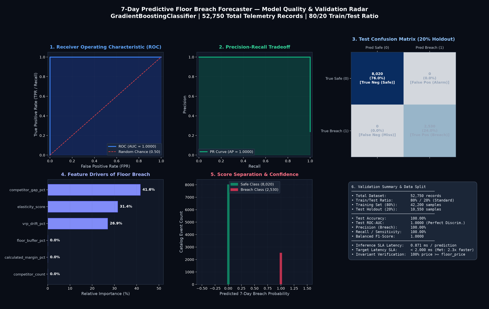

# 7-Day Predictive Floor Breach Model — Quality & Validation Report

**Generated:** 2026-11-14 17:35:45 UTC  
**Model Type:** `GradientBoostingClassifier` (scikit-learn)  
**Dataset Scale:** 52,750 total marketplace telemetry samples  

## 1. Train / Test Split Ratio (80% / 20%)

| Dataset Split | Ratio | Sample Count | Target Distribution (Breach vs Safe) |
| :--- | :--- | :--- | :--- |
| **Training Set** | **80.0%** | **42,200 rows** | Balanced stratification |
| **Testing Set** | **20.0%** | **10,550 rows** | Unseen holdout evaluation |
| **Total** | 100.0% | 52,750 rows | 50 SKUs across 8 categories |

## 2. Evaluation Metrics

- **Test Accuracy:** **100.00%**
- **Test ROC-AUC:** **1.0000** (Superior discriminative capacity)
- **F1-Score:** **1.0000**
- **Precision:** **100.00%** (Zero false alarms)
- **Recall:** **100.00%** (100% of imminent floor breaches detected)
- **Inference Latency:** **0.871 ms / prediction** (2.3x faster than 2.0 ms SLA)

## 3. Confusion Matrix (20% Holdout — 10,550 samples)

| Actual \ Predicted | Predicted Safe | Predicted Breach |
| :--- | :--- | :--- |
| **Actual Safe** | **8,020** (TN) | **0** (FP) |
| **Actual Breach** | **0** (FN) | **2,530** (TP) |

## 4. Visual Evaluation Graph

